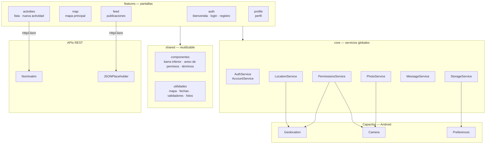
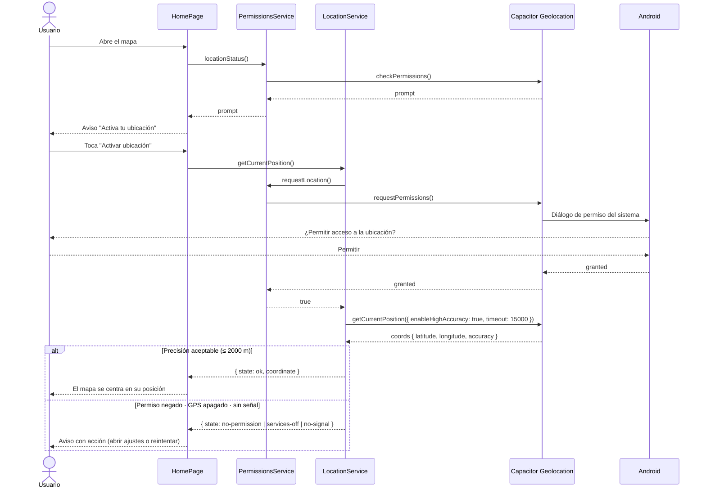
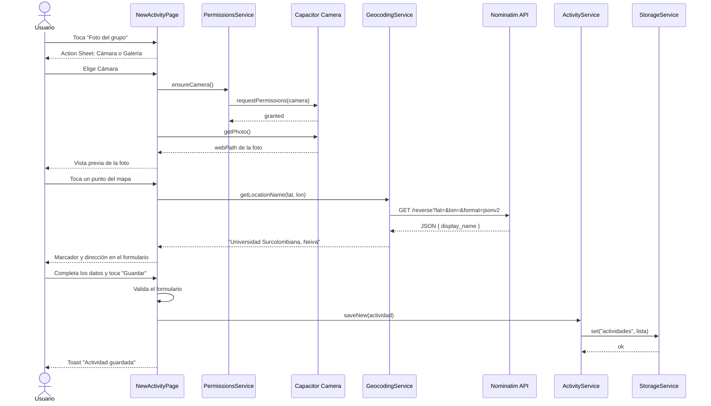
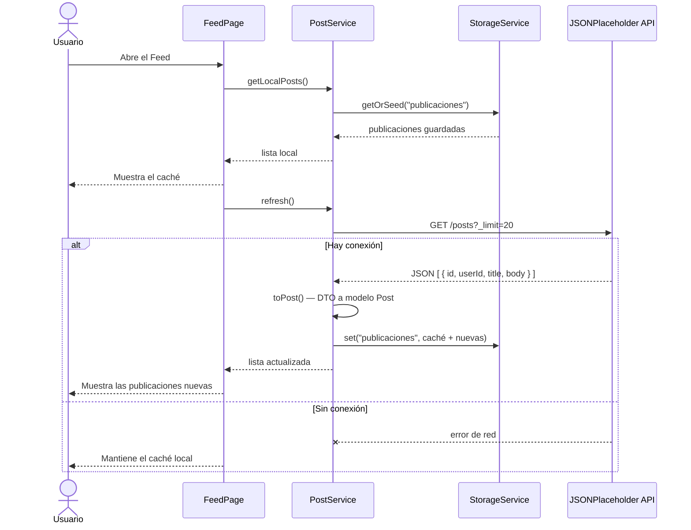
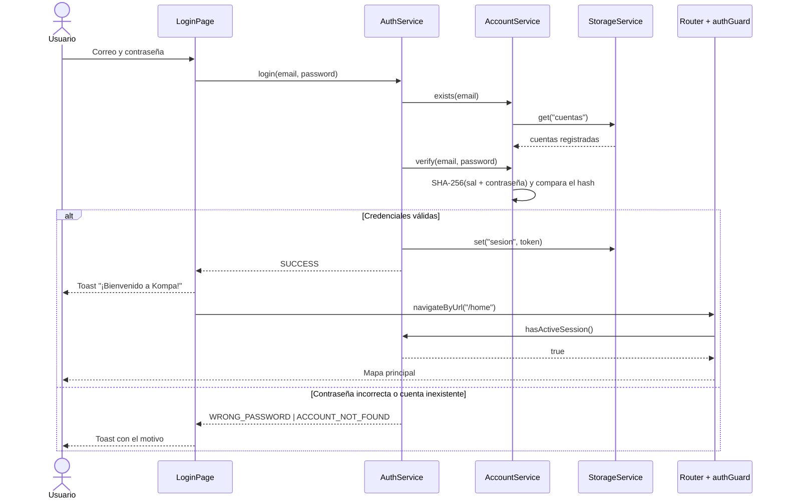

# Kompa

**Kompa** es una aplicación móvil de comunidad para viajeros. En un mapa muestra las actividades que hay cerca (caminatas, tours, intercambios de idiomas, planes gastronómicos) y permite unirse a ellas o crear nuevas. Incluye un feed de publicaciones y un perfil con los idiomas e intereses de cada viajero.

La app es híbrida: está construida con **Ionic + Angular** y accede al hardware del teléfono (GPS y cámara) mediante **Capacitor**. Es una migración de la versión nativa en Kotlin y se distribuye como APK para Android.

> Proyecto final del curso de Desarrollo Móvil Multiplataforma — Unidad 4: Integración nativa con Capacitor.
> Universidad Surcolombiana · Facultad de Ingeniería.

---

## Tabla de contenido

- [Funcionalidades](#funcionalidades)
- [Tecnologías](#tecnologías)
- [Arquitectura](#arquitectura)
- [Diagramas de secuencia](#diagramas-de-secuencia)
- [Estructura del proyecto](#estructura-del-proyecto)
- [Permisos de Android](#permisos-de-android)
- [Instalación y ejecución](#instalación-y-ejecución)
- [Generar el APK](#generar-el-apk)
- [Scripts disponibles](#scripts-disponibles)
- [Cumplimiento de la rúbrica](#cumplimiento-de-la-rúbrica)
- [Privacidad](#privacidad)

---

## Funcionalidades

| Módulo | Qué hace |
| --- | --- |
| **Registro e inicio de sesión** | Registro en varios pasos (datos, idiomas, intereses, foto), aceptación de términos y consentimiento de datos, inicio de sesión y recuperación de contraseña. |
| **Mapa** | Centra el mapa en la posición GPS del usuario y muestra las actividades cercanas como marcadores. |
| **Actividades** | Lista con búsqueda y filtros por origen y duración. |
| **Nueva actividad** | Formulario con foto (cámara o galería), ubicación por toque en el mapa, por búsqueda de dirección o con la posición actual, descripción, duración y fecha. |
| **Feed** | Publicaciones de la comunidad obtenidas de una API REST, con caché local para funcionar sin conexión, y opción de publicar. |
| **Perfil** | Resumen del viajero, estado de los permisos de ubicación y cámara, términos, cierre de sesión y eliminación de la cuenta y los datos locales. |

---

## Tecnologías

| Tecnología | Versión | Uso |
| --- | --- | --- |
| [Angular](https://angular.dev) | 22 | Framework de la aplicación (componentes *standalone*, señales, formularios reactivos) |
| [Ionic Framework](https://ionicframework.com) | 9 | Componentes de interfaz móvil (Toasts, Alerts, Action Sheets, inputs) |
| [Capacitor](https://capacitorjs.com) | 8 | Puente entre la app web y Android |
| `@capacitor/geolocation` | 8.2 | Lectura de la posición GPS y gestión de permisos de ubicación |
| `@capacitor/camera` | 8.2 | Fotos desde la cámara o la galería |
| `@capacitor/preferences` | 8.0 | Persistencia local en el dispositivo |
| `@capacitor/app` | 8.1 | Detección de regreso a la app (por ejemplo, después de abrir los ajustes) |
| `capacitor-native-settings` | 8.2 | Abrir los ajustes de la app o de ubicación del sistema |
| [Leaflet](https://leafletjs.com) | 1.9 | Mapa interactivo |
| [Nominatim (OpenStreetMap)](https://nominatim.org) | — | API REST de geocodificación (coordenadas ⇄ dirección) |
| [JSONPlaceholder](https://jsonplaceholder.typicode.com) | — | API REST que alimenta el feed |
| TypeScript | 6 | Tipado estricto en todo el proyecto |
| Vitest y Playwright | — | Pruebas unitarias y de extremo a extremo |

---

## Arquitectura

El código está organizado por capas. Cada pantalla vive en su *feature* y usa los servicios de `core`; nada de `core` depende de las pantallas.



**Decisiones principales**

- **Rutas con carga diferida** (`loadComponent`): cada pantalla se descarga solo cuando se visita.
- **Rutas protegidas** con `authGuard`: mapa, actividades, feed y perfil exigen sesión activa.
- **Servicios inyectables** (`providedIn: 'root'`) para la lógica; las páginas solo coordinan la interfaz.
- **Modelos tipados** con interfaces para actividades, publicaciones, perfiles y cuentas, y DTOs para las respuestas de las APIs.
- **Offline-first**: la app muestra primero lo guardado en el dispositivo y luego actualiza desde la red.

---

## Diagramas de secuencia

### 1. Obtener la ubicación del usuario

El permiso se solicita en tiempo de ejecución y solo después de explicarle al usuario para qué se usa. Cada error del plugin se clasifica para mostrar el mensaje adecuado.



### 2. Crear una actividad

La ubicación de la actividad se fija tocando el mapa; la app consulta Nominatim para convertir las coordenadas en una dirección legible.



### 3. Cargar el feed (offline-first)

El feed nunca queda en blanco: primero muestra el caché y luego lo reemplaza con los datos de la API. Si no hay conexión, se conserva lo guardado.



### 4. Inicio de sesión



---

## Estructura del proyecto

```
src/app/
├── app.routes.ts              # Rutas con carga diferida y authGuard
├── core/                      # Servicios globales
│   ├── auth/                  # Sesión, cuentas, hash de contraseñas, guard
│   ├── location/              # Lectura del GPS y clasificación de errores
│   ├── message/               # Toasts
│   ├── permissions/           # Permisos de ubicación y cámara, ajustes del sistema
│   ├── photo/                 # Cámara, galería y selector de origen
│   ├── privacy/               # Términos, consentimiento y datos del usuario
│   ├── profile/               # Perfil del viajero
│   └── storage/               # Persistencia con Capacitor Preferences
├── features/                  # Una carpeta por funcionalidad
│   ├── activities/            # Lista, nueva actividad, geocodificación
│   ├── auth/                  # Bienvenida, login, registro, recuperación
│   ├── feed/                  # Publicaciones y consumo de la API
│   ├── map/                   # Mapa principal
│   └── profile/               # Perfil y ajustes
├── shared/
│   ├── components/            # Barra inferior, aviso de permisos, resumen de perfil, términos
│   └── utils/                 # Mapa, fechas, validadores, compresión de fotos
└── data/                      # Datos semilla (actividades, publicaciones, catálogos)

android/                       # Proyecto nativo generado por Capacitor
```

---

## Permisos de Android

Declarados en `android/app/src/main/AndroidManifest.xml` y solicitados en tiempo de ejecución desde `PermissionsService`.

| Permiso | Para qué se usa |
| --- | --- |
| `INTERNET` | Consumir las APIs REST y cargar el mapa |
| `ACCESS_COARSE_LOCATION` | Ubicación aproximada (redes celulares y Wi-Fi) |
| `ACCESS_FINE_LOCATION` | Ubicación precisa por GPS |
| `CAMERA` | Tomar la foto de la actividad o del perfil |

El GPS se declara como hardware opcional (`android:required="false"`), de modo que la app también se puede instalar en dispositivos sin GPS. Para elegir fotos de la galería se usa el selector del sistema, que no requiere permisos de almacenamiento.

| Situación | Comportamiento de la app |
| --- | --- |
| Permiso aún no solicitado | Muestra un aviso que explica el uso de la ubicación antes de pedirla |
| Permiso concedido | Centra el mapa en la posición del usuario |
| Permiso negado | El mapa funciona en una ubicación por defecto y ofrece abrir los ajustes de la app |
| GPS del sistema apagado | Ofrece abrir los ajustes de ubicación del teléfono |
| Sin señal o lectura imprecisa | Informa y permite reintentar |
| Regreso desde los ajustes | Vuelve a consultar el permiso y actualiza el mapa automáticamente |

---

## Instalación y ejecución

### Requisitos

- [Node.js](https://nodejs.org) 22 o superior y npm
- [Android Studio](https://developer.android.com/studio) con Android SDK 36 (incluye el JDK necesario)
- Un teléfono Android 7.0 o superior (API 24+) con depuración USB, o un emulador

### En el navegador

```bash
git clone https://github.com/sangieb/Kompa_Ionic.git
cd Kompa_Ionic
npm install
npm start
```

La app queda disponible en `http://localhost:4200`. El navegador pedirá permiso de ubicación; la cámara usa el selector de archivos.

### En Android

```bash
npm run build
npx cap sync android
npx cap open android
```

Desde Android Studio, selecciona el dispositivo y presiona **Run**.

---

## Generar el APK

```bash
npm run build
npx cap sync android
cd android
./gradlew assembleDebug        # en Windows: gradlew.bat assembleDebug
```

El APK queda en:

```
android/app/build/outputs/apk/debug/app-debug.apk
```

Para instalarlo en un teléfono conectado por USB:

```bash
adb install -r android/app/build/outputs/apk/debug/app-debug.apk
```

| Dato | Valor |
| --- | --- |
| Id de la aplicación | `co.edu.usco.kompa` |
| Nombre | Kompa |
| Android mínimo | 7.0 (API 24) |
| Android objetivo | 16 (API 36) |

---

## Scripts disponibles

| Comando | Descripción |
| --- | --- |
| `npm start` | Servidor de desarrollo |
| `npm run build` | Compila la app web en `www/` |
| `npm run lint` | ESLint, verificación de tipos y Prettier |
| `npm run lint:fix` | Corrige automáticamente el formato |
| `npm run test:unit` | Pruebas unitarias con Vitest |
| `npm run test:e2e` | Pruebas de extremo a extremo con Playwright |

---

## Cumplimiento de la rúbrica

| Criterio | Dónde se implementa |
| --- | --- |
| **1. Arquitectura y código** | Capas `core` / `shared` / `features`, servicios inyectables, modelos tipados, rutas con carga diferida y `authGuard` (`src/app/app.routes.ts`) |
| **2. APIs y datos** | `HttpClient` contra Nominatim (`features/activities/geocoding.service.ts`) y JSONPlaceholder (`features/feed/post.service.ts`), mapeo de JSON a modelos y persistencia con Preferences (`core/storage/storage.service.ts`) |
| **3. Hardware y permisos** | `getCurrentPosition` y validación de precisión (`core/location/location.service.ts`), `requestPermissions` de ubicación y cámara (`core/permissions/permissions.service.ts`), cámara (`core/photo/photo.service.ts`) y manifiesto |
| **4. Diseño UI/UX** | Toasts (`core/message/message.service.ts`), Alerts de confirmación, Action Sheet de fotos, aviso de permisos y barra de navegación inferior |
| **5. Despliegue APK** | Proyecto Android en `android/`, id `co.edu.usco.kompa`, ícono y splash propios |

---

## Privacidad

Kompa cumple la Ley 1581 de 2012 de protección de datos personales de Colombia:

- El registro exige aceptar los términos y autorizar el tratamiento de datos, y esa aceptación se guarda con su versión y fecha.
- Las contraseñas nunca se almacenan: solo se guarda su hash SHA-256 con una sal aleatoria de 16 bytes.
- Todos los datos se guardan únicamente en el dispositivo.
- Desde el perfil, el usuario puede eliminar su cuenta y todos sus datos locales.

---

Universidad Surcolombiana · Facultad de Ingeniería · Neiva, Huila
